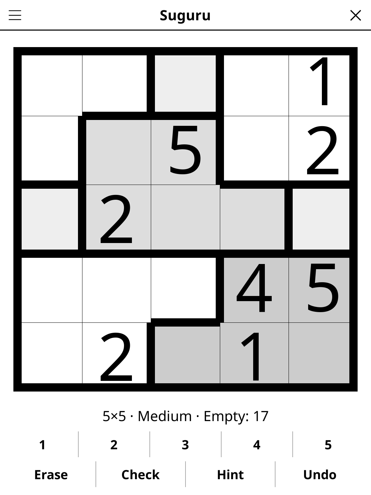

# suguru.koplugin

A Suguru puzzle plugin for [KOReader](https://github.com/koreader/koreader).

## Screenshot

## Rules

Fill every cell so each outlined group of size N contains 1–N exactly once. Identical numbers may never be in adjacent cells — including diagonally adjacent.

## Features

- **Multiple grid sizes**
- **Three difficulty levels** — Easy needs only the basic rules; Medium adds a few harder deductions (a digit whose every place in a cage touches the same outside cell, pairs locked into two cells); Hard shows fewer digits and needs many more of them. Every puzzle has a single solution and can be solved by logic alone, without guessing
- **Group highlighting** — outlined cages are clearly shown
- **Check** — highlights adjacency or group violations
- **Hint** — two taps: the first says which cell is about to give, the second acts on it. A cell that contradicts the solution is always reported before a fresh one is revealed
- **Auto-save** — puzzle state saved and restored on next launch

## Installation

1. Download `suguru.koplugin.zip` from the [latest release](../../releases/latest).
2. Extract into the `plugins/` folder of your KOReader data directory.
3. Restart KOReader.
4. Open the menu → **Tools** → **Suguru**.

## Controls

| Action | How |
|--------|-----|
| Select a cell | Tap it |
| Enter a number | Tap the digit button |
| Erase a cell | Tap **Erase** |
| Check progress | Tap **Check** |
| New puzzle | Tap **New game** |
| Show rules | Tap **Rules** |

## License

GPL-3.0 — see [LICENSE](LICENSE).
